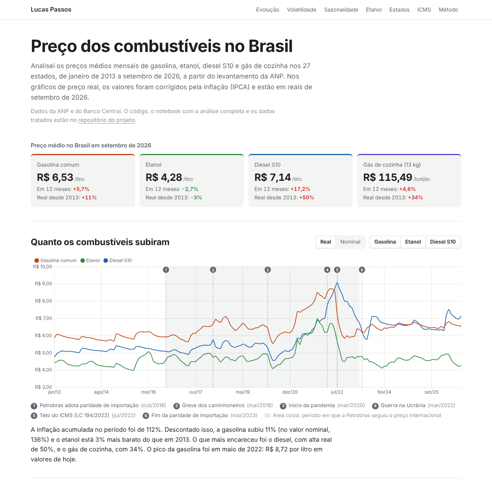
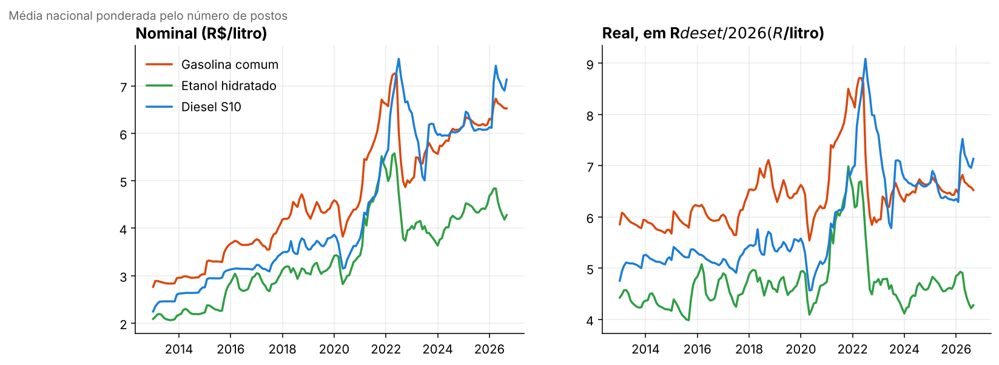
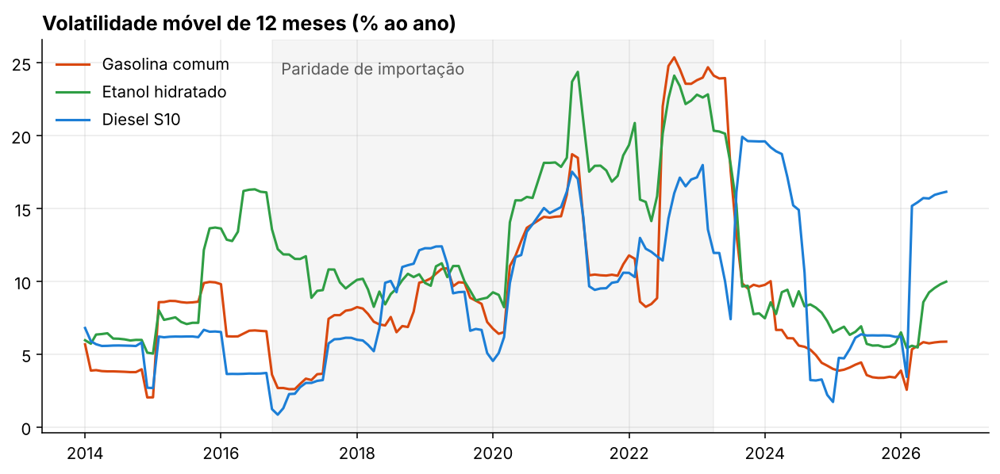
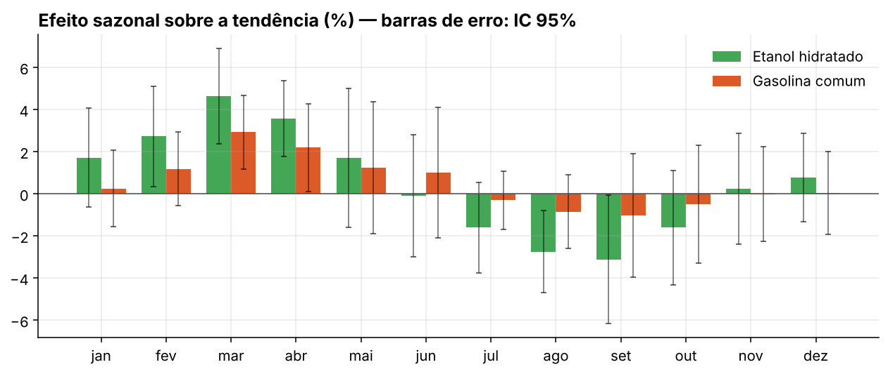
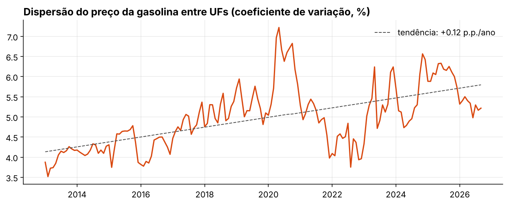
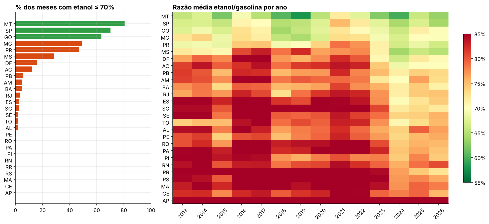
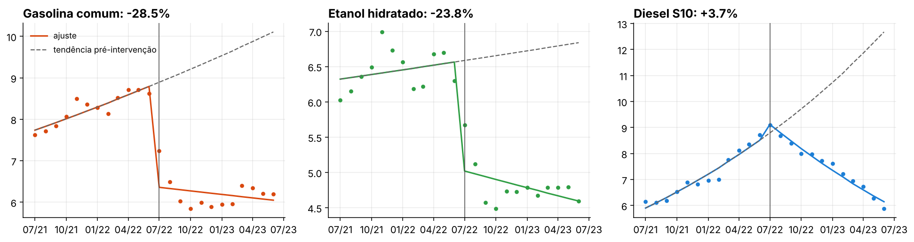

# Preços de Combustíveis no Brasil (2013–2026)

[](https://github.com/oLucas-Passos/precos-combustiveis-brasil/actions/workflows/ci.yml)


Análise estatística dos preços de revenda de gasolina, etanol, diesel S10 e GLP nas 27 UFs, com dados oficiais da ANP deflacionados pelo IPCA. O projeto tem três partes: um pacote Python com pipeline testado, um notebook com a análise completa e um dashboard interativo.

**[Dashboard](https://olucas-passos.github.io/precos-combustiveis-brasil/)** · **[Notebook](notebooks/analise.ipynb)** · **[Resumo em JSON](data/processed/resumo.json)**



## Principais resultados

| # | Pergunta | Resultado |
|---|---|---|
| 1 | Alta **real** desde jan/2013 | Gasolina **+11%**, etanol **−3%**, diesel S10 **+50%**, GLP **+34%** (IPCA acumulado: 112%) |
| 2 | Volatilidade e política da Petrobras | Na paridade de importação (out/2016–abr/2023), volatilidade da gasolina **2,2×** maior: 14,1% contra 6,3% a.a. Depois de mai/2023 a gasolina voltou a 5,2%; o diesel continuou em 13,1% |
| 3 | Sazonalidade | Etanol **+4,6%** acima da tendência em março e **−3,1%** em setembro, em linha com a safra de cana no Centro-Sul. Gasolina sem padrão relevante |
| 4 | Competitividade do etanol | Etanol ≤ 70% da gasolina em 80% dos meses em MT, 70% em SP e 63% em GO. **Nunca** em AP, CE, MA, PI, RN, RR e RS |
| 5 | Dispersão entre UFs | CV em alta: **4,0%** (2013) → **5,5%** (últimos 12 meses). Comprimido em ~4% entre nov/2021 e dez/2022, durante o congelamento e o teto do ICMS |
| 6 | Teto do ICMS (LC 194/2022) | Quebra de nível de **−28,5%** na gasolina (IC 95%: −35,0% a −21,4%) e **−23,8%** no etanol; **sem quebra no diesel** (IC inclui zero) |

<details>
<summary><b>Figuras do notebook</b></summary>

| | |
|---|---|
|  |  |
|  |  |
|  |  |

</details>

## Metodologia

**Preço real.** Número-índice do IPCA com base 1 em set/2026; `preço_real(t) = preço(t) / I(t)`.

**Média nacional.** Média dos preços estaduais ponderada pelo número de postos pesquisados em cada UF e mês.

**Volatilidade.** Desvio padrão dos retornos log mensais (`Δ log p`), anualizado por √12, calculado em três regimes de preço da Petrobras: administrado (até set/2016), paridade de importação (out/2016 a abr/2023) e política comercial atual (desde mai/2023).

**Sazonalidade.** Desvio do log do preço em relação a uma média móvel centrada 2×12, agregado por mês do calendário, com IC 95% pelo erro padrão da média.

**Paridade do etanol.** Razão `p_etanol / p_gasolina` por UF e mês, comparada ao limite de 70% (rendimento energético aproximado).

**Dispersão regional.** Coeficiente de variação dos preços entre as 27 UFs em cada mês, com tendência linear por MQO.

**Série interrompida (ITS).** Regressão segmentada em log do preço real nacional, ±12 meses de jul/2022:

```
log p_t = β0 + β1·t + β2·D_t + β3·(t − t0)·D_t + ε_t
```

`β2` é a mudança imediata de nível (reportada como `exp(β2) − 1`). Erros padrão HAC (Newey-West, 3 defasagens). Sensibilidade testada com janelas de 6 a 24 meses: a quebra na gasolina fica entre −23% e −33%.

### Limitações

- Médias estaduais escondem a variação entre municípios e postos.
- A amostra da ANP mudou ao longo do tempo; não houve pesquisa em set/2020 (lacuna mantida, sem interpolação).
- Volatilidade por regime e ITS são **associações temporais**. Em jul/2022, cortes de preço da Petrobras e a queda do petróleo coincidiram com o teto do ICMS; o `β2` mede a variação total associada ao período, não o efeito isolado do imposto.

## Arquitetura

```
src/combustiveis/
├── config.py          caminhos, mapeamentos de UF/produto, regimes e eventos
├── ingestao.py        leitura da planilha da ANP e das séries do BCB
├── validacao.py       regras de qualidade (bloqueantes e avisos)
├── transformacao.py   deflação pelo IPCA, média ponderada, tabelas largas
├── metricas.py        volatilidade, sazonalidade, dispersão, paridade, ITS
└── pipeline.py        orquestra tudo e exporta data/processed e data/precos.json
tests/                 26 testes (unitários com dados sintéticos + integração com dados reais)
notebooks/analise.ipynb
index.html, css/, js/  dashboard estático (Chart.js), publicado no GitHub Pages
```

**Validação.** O pipeline para se encontrar UF não mapeada, chave `(mês, produto, UF)` duplicada, preço fora de faixa plausível ou média fora do intervalo [mín, máx] informado pela ANP. Meses sem pesquisa geram aviso.

**Testes.** As métricas são testadas contra propriedades conhecidas: recuperação de um padrão sazonal injetado, estimação de uma quebra de nível sintética de −20% na ITS, ausência de quebra em série sem intervenção, ponderação da média nacional e deflação. Cobertura de 91%.

## Como reproduzir

```bash
git clone https://github.com/oLucas-Passos/precos-combustiveis-brasil.git
cd precos-combustiveis-brasil
pip install -e ".[dev,notebook]"

make testes      # pytest + cobertura
make dados       # python -m combustiveis -> data/processed/ e data/precos.json
make notebook    # reexecuta notebooks/analise.ipynb
make servir      # dashboard em http://localhost:8000
```

## Dados

| Arquivo | Descrição |
|---|---|
| `data/raw/mensal-estados-desde-jan2013.xlsx` | [ANP, Série histórica do Levantamento de Preços](https://www.gov.br/anp/pt-br/assuntos/precos-e-defesa-da-concorrencia/precos/precos-revenda-e-de-distribuicao-combustiveis/serie-historica-do-levantamento-de-precos), média mensal por UF |
| `data/raw/ipca_bcb_433.csv` | [BCB, SGS 433](https://www3.bcb.gov.br/sgspub/): IPCA, variação mensal (%) |
| `data/processed/painel_precos.csv` | Painel limpo: `mes, produto, regiao, uf, postos, preco, desvio, preco_min, preco_max, preco_real` |
| `data/processed/resumo.json` | Todas as estatísticas citadas neste README |
| `data/precos.json` | Dados agregados consumidos pelo dashboard |

## Próximos passos

- Incluir Brent e câmbio para estimar a velocidade de repasse (pass-through) em cada regime.
- Usar alíquotas de ICMS por UF para estimar o efeito do teto com diferenças em diferenças com intensidade de tratamento.
- Descer ao nível de município com os microdados semestrais da ANP.

## Autor

**Lucas Passos** · [github.com/oLucas-Passos](https://github.com/oLucas-Passos)
